# E1-1codyssey

## 📌 프로젝트 소개

Codyssey 1-1 과제를 위한 Docker 기반 웹 서버 및 개발 환경 실습 프로젝트입니다.

## 💻 실행 환경

- OS: Windows 11

- Shell: PowerShell / WSL(Ubuntu)

- Python: 3.14.4

- **Git (Windows)**: 2.55.0.windows.3

- **Git (Ubuntu/WSL)**: 2.53.0

## ⚙️ 환경 설치

1. Git 설치

   - [https://git-scm.com](https://git-scm.com/) 에서 다운로드 후 설치

2. Python 설치

   - [https://python.org](https://python.org/) 에서 다운로드 후 설치

3. 저장소 클론

4. Git 사용자 정보 설정
### Git 사용자 설정 및 원격 저장소 연결 확인

Git 사용자 정보와 GitHub 원격 저장소 연결 상태를 확인하였다.

**1) Git 설정 확인**

```bash
git config --list
```

실행 결과:

```text
user.name=yeppy82
user.email=yeppy82@gmail.com
core.repositoryformatversion=0
core.filemode=true
core.bare=false
core.logallrefupdates=true
core.whitespace=cr-at-eol
remote.origin.url=https://github.com/yeppy82/E1-1codyssey.git
remote.origin.fetch=+refs/heads/*:refs/remotes/origin/*
branch.main.remote=origin
```

**2) 원격 저장소 연결 확인**

```bash
git remote -v
```

실행 결과:

```text
origin  https://github.com/yeppy82/E1-1codyssey.git (fetch)
origin  https://github.com/yeppy82/E1-1codyssey.git (push)
```

**확인 결과:** Git 사용자 정보가 설정되어 있으며, GitHub 저장소가 origin이라는 원격 저장소로 등록되어 있다. Fetch와 Push 주소가 동일한 저장소를 가리키므로 원격 저장소와의 연동이 정상적으로 구성되었음을 확인하였다.

## 📁 폴더 구조

```text

E1-1codyssey/

├── docs/

│   └── screenshots/

├── logs/

├── src/

│   ├── docker-web/

│   │   ├── Dockerfile

│   │   └── index.html

│   └── terminal-practice/

│       └── original.txt

├── .gitignore

├── hello.txt

└── README.md

```

## ✅ 진행 현황

- [x] GitHub 저장소 생성

- [x] 프로젝트 폴더 구조 생성

- [x] README.md 작성

- [x] 학교/집 컴퓨터 Git 환경 설정

- [x] GitHub 연동 완료

- [x] WSL2 Ubuntu 환경 설정

- [x] Git 및 Python 설치 확인

- [x] Docker 설치 및 실행 확인

- [x] Docker 컨테이너 실습

- [x] Linux 터미널 기본 명령어 실습

- [x] 파일 및 디렉터리 권한 실습

- [x] Dockerfile 기반 사용자 정의 웹 서버 제작

- [x] 포트 매핑 및 브라우저 접속 확인

- [x] Bind Mount 실습

- [x] Docker Volume 데이터 영속성 실습

- [x] GitHub 최종 업로드

## 터미널 조작 실습

### 환경 확인 단계

- [x]Windows에서 WSL2 Ubuntu가 실행되는지 확인한다.

- [X] 현재 사용 중인 리눅스 배포판이 Ubuntu인지 확인한다.

- [X] Shell 종류를 확인한다.

- [X] 터미널 프로그램을 확인한다. 예: Windows Terminal, VSCode Terminal.

- [X] Git이 설치되어 있는지 확인한다.

- [X] Docker가 WSL2에서 동작하는지 확인한다.

- [x] Docker 데몬이 정상 실행 중인지 확인한다.

- [x] 확인 결과를 README의 “실행 환경” 섹션에 기록한다.

## 실행 환경

### 시스템 정보

- **OS**: Windows 11 (WSL2)

- **Linux 배포판**: Ubuntu 26.04.1 LTS

- **Shell**: Bash (/bin/bash)

- **Terminal**: VS Code 통합 터미널 / Windows PowerShell

- **IDE**: Visual Studio Code

### 개발 도구

- **Python**: 3.14.4

- **Git (Ubuntu)**: 2.53.0

- **Docker**: 29.9.2 (build a82e528)

- **Docker Desktop**: 실행 중

- **Docker Engine**: 정상 연결 확인

### 확인 명령어

실행 환경 확인을 위해 다음 명령어를 사용하였다.

**1. Ubuntu 버전 확인**

```bash

lsb_release -a

```

확인 결과: Ubuntu 26.04.1 LTS

**2. Shell 확인**

```bash

echo $SHELL

```

확인 결과: /bin/bash

**3. Python 버전 확인**

```bash

python3 --version

```

확인 결과: Python 3.14.4

**4. Git 버전 확인**

```bash

git --version

```

확인 결과: git version 2.53.0

**5. Docker 버전 확인**

```bash

docker --version

```

확인 결과: Docker version 29.9.2, build a82e528

**6. Docker Engine 연결 확인**

```bash

docker info

```

확인 결과:

- Docker Client 정상 확인

- Docker Server 정보 출력 확인

- Docker Engine 연결 확인

#### Git 병합 충돌 해결

- **상황**: 로컬과 GitHub에서 동시에 README.md 수정

- **원인**: 협업 환경에서 같은 파일을 두 곳에서 수정

- **해결 방법**:

  1. VS Code에서 충돌 부분 확인

  2. 중복 내용 정리 및 수동 병합

  3. `git add README.md` 실행

  4. `git commit -m "fix: README.md 병합 충돌 해결"` 커밋

  5. `git push origin main` 푸시

- **결과**: ✅ 로컬-GitHub 동기화 완료

#### 학습 내용

- Git 충돌은 협업 과정에서 발생할 수 있다.

- 충돌 해결은 로컬에서 수정한 후 커밋 및 푸시하는 순서로 진행한다.

- 향후 예방을 위해 수정 전 원격 저장소와 동기화한다.

### ✅ 환경 설정 체크리스트

- [x] Windows에서 WSL2 Ubuntu 설정 확인

- [x] 현재 사용 중인 리눅스 배포판이 Ubuntu 확인

- [x] Git 설치 및 버전 확인

- [x] Python 설치 및 버전 확인

- [x] Docker 설치 및 실행 확인

- [x] GitHub 저장소 생성 및 연동

- [x] README.md 작성

- [x] Git 병합 충돌 해결

### 터미널 기본 조작 실습

본 실습은 Windows PowerShell을 사용하여 프로젝트 디렉토리 확인, 파일 목록 조회, 디렉토리 이동, 파일 생성 및 파일 내용 확인을 진행하였다.

1️⃣ 현재 위치 확인 (pwd) pwd 실행결과 C:\Users\yeppy829155\Desktop\E1-1codyssey

2️⃣ 일반 파일 목록 확인 (ls) ls 실행결과 디렉터리: C:\Users\yeppy829155\Desktop\E1-1codyssey docs logs src README.md

3️⃣ 숨김 파일 포함 목록 확인 (ls -Hidden) ls -Hidden

디렉터리: C:\Users\yeppy829155\Desktop\E1-1codyssey

Mode LastWriteTime Length Name

**---**

d--h-- 2026-11-16 오후 8:24 .git

4️⃣ src 폴더로 이동 (cd src) cd src pwd 실행결과 C:\Users\yeppy829155\Desktop\E1-1codyssey\src

5️⃣ 파일 생성 (New-Item hello.txt -ItemType File) New-Item hello.txt -ItemType File

디렉터리: C:\Users\yeppy829155\Desktop\E1-1codyssey\src

Mode LastWriteTime Length Name

**---**

-a---- 2026-11-16 오후 8:46 0 hello.txt

6️⃣ 파일에 내용 작성 (echo & 리다이렉션)

**파일에 텍스트 작성:** echo "Hello, WSL2!" > hello.txt

7️⃣ 파일 내용 확인 (cat)

**파일 내용 출력:** cat hello.txt Hello, WSL2!

8. 실습 결과 및 학습 내용

| 명령어        | 기능              |

| :--------- | :-------------- |

| pwd        | 현재 작업 위치 확인     |

| ls         | 파일 및 디렉토리 목록 확인 |

| ls -Hidden | 숨김 파일 확인        |

| cd         | 디렉토리 이동         |

| New-Item   | 새 파일 생성         |

| echo       | 문자열 출력 및 파일 기록  |

| >          | 출력 결과를 파일에 저장   |

| cat        | 파일 내용 확인        |

실습을 통해 PowerShell의 기본 파일 및 디렉토리 관리 명령어를 익혔다.

**---**

## 🐳 Docker 컨테이너 실습

### 1. Hello World 컨테이너 실행

```bash

docker run hello-world

```

실행 결과:

- Docker Hub에서 hello-world 이미지 다운로드

- Hello from Docker! 메시지 출력

- Docker 컨테이너 정상 실행 확인

### 2. 이미지 및 컨테이너 확인

```bash

docker images

docker ps -a

```

실행 결과:

- 다운로드된 Docker 이미지 확인

- 컨테이너 실행 및 종료 상태 확인

### 3. Ubuntu 컨테이너 실행

```bash

docker run -it ubuntu bash

```

컨테이너 내부에서 다음 명령어 실행:

```bash

whoami

pwd

cat /etc/os-release

ls -la

```

실행 결과:

- 사용자: root

- 작업 위치: /

- Ubuntu 26.04.1 LTS 확인

- 컨테이너 내부 파일 및 디렉터리 확인

### 4. 컨테이너 재실행

```bash

docker start -ai bffe3c5c99e0

```

기존 Ubuntu 컨테이너를 다시 실행하고 내부 셸에 접속하였다.

### 5. 컨테이너 내부 파일 생성 및 데이터 유지 확인

파일 생성:

```bash

echo "Docker data persistence test" > test.txt

```

파일 내용 확인:

```bash

cat test.txt

```

컨테이너 종료 후 다시 실행하여 파일 내용을 확인하였다.

실행 결과:

- 컨테이너 종료 후에도 test.txt 유지 확인

- 동일 컨테이너 재실행 후 파일 내용 정상 출력

### 6. Nginx 웹 서버 실행

```bash

docker run -d -p 8080:80 --name my-web nginx

```

실행 결과:

- Nginx 이미지 다운로드

- my-web 컨테이너 생성 및 실행

- 호스트 8080 포트와 컨테이너 80 포트 연결

### 7. 웹 서버 접속 확인

```bash

docker ps

```

웹 브라우저 접속 주소:

[http://localhost:8080](http://localhost:8080/)

실행 결과:

- 컨테이너 실행 상태 Up 확인

- 브라우저에서 Welcome to nginx! 화면 출력 확인

### 8. 웹 서버 종료

```bash

docker stop my-web

```

실행 결과:

- my-web 컨테이너 정상 종료

- 컨테이너 삭제 없이 중지 상태 확인

### 9. 실습 결과 및 학습 내용

| 명령어            | 기능              |

| :------------- | :-------------- |

| docker run     | 새 컨테이너 생성 및 실행  |

| docker images  | 이미지 목록 확인       |

| docker ps      | 실행 중인 컨테이너 확인   |

| docker ps -a   | 전체 컨테이너 확인      |

| docker start   | 기존 컨테이너 재실행     |

| docker stop    | 컨테이너 중지         |

| docker rm      | 컨테이너 삭제         |

| docker run -it | 대화형 터미널 실행      |

| docker run -d  | 백그라운드 실행        |

| -p             | 호스트와 컨테이너 포트 연결 |

| exit           | 컨테이너 내부 셸 종료    |

**학습 내용**

Docker 이미지를 이용하여 Ubuntu 컨테이너를 생성하고 내부 환경을 확인하였다. 컨테이너 내부에 파일을 생성한 후 종료 및 재실행을 통해 데이터 유지 여부를 확인하였다.

또한 Nginx 웹 서버를 Docker 컨테이너로 실행하고 포트 연결을 설정하여 웹 브라우저에서 정상적으로 접속되는 것을 확인하였다.

이번 실습을 통해 Docker 이미지와 컨테이너의 차이, 컨테이너의 생성 및 실행, 종료, 재실행 과정과 기본적인 웹 서버 실행 방법을 익혔다.

## 10. Linux 터미널 기본 조작 실습

### 10-1. 실습 목적

Linux 터미널을 이용하여 디렉토리 및 파일의 생성, 복사, 이동, 이름 변경, 삭제와 파일 내용 확인 등의 기본 명령어를 학습하였다.

### 10-2. 수행 명령어

| 명령어      | 기능               |

| :------- | :--------------- |

| `pwd`    | 현재 작업 위치 확인      |

| `ls -la` | 숨김 파일을 포함한 목록 확인 |

| `mkdir`  | 디렉토리 생성          |

| `touch`  | 빈 파일 생성          |

| `echo`   | 텍스트 입력 및 파일 저장   |

| `cat`    | 파일 내용 확인         |

| `cp`     | 파일 복사            |

| `mv`     | 파일 이동 및 이름 변경    |

| `rm`     | 파일 삭제            |

| `rmdir`  | 빈 디렉토리 삭제        |

### 10-3. 실습 결과

- `original.txt` 파일 생성 및 내용 작성

- `copy.txt` 파일 복사 후 `renamed.txt`로 이름 변경

- `backup` 디렉토리 생성 및 파일 이동

- 파일 삭제 및 빈 디렉토리 삭제

- `ls -la`를 이용한 최종 디렉토리 상태 확인

### 10-4. Linux 파일 및 디렉토리 권한 실습

Linux의 권한은 읽기(r), 쓰기(w), 실행(x)으로 구성되며 숫자로 표현할 수 있다.

| 권한 | 의미 | 숫자 |

| :- | :- | :- |

| r  | 읽기 | 4  |

| w  | 쓰기 | 2  |

| x  | 실행 | 1  |

**파일 권한 변경**

```bash

ls -l original.txt

chmod 600 original.txt

ls -l original.txt

```

변경 전: `644` (`-rw-r--r--`)

변경 후: `600` (`-rw-------`)

**디렉토리 권한 변경**

```bash

mkdir practice-dir

ls -ld practice-dir

chmod 700 practice-dir

ls -ld practice-dir

```

변경 전: `755` (`drwxr-xr-x`)

변경 후: `700` (`drwx------`)

### 10-5. 트러블슈팅

**문제 1. 파일 삭제 시 No such file or directory 오류**

- 원인: 삭제하려는 파일이 현재 디렉토리가 아닌 backup 디렉토리에 위치함

- 확인: `ls -l`, `ls -l backup/`

- 해결: `rm backup/renamed.txt` 명령으로 정확한 경로 지정

**문제 2. Git diff --check에서 줄바꿈 관련 공백 오류 발생**

- 원인: Windows 환경에서 작성한 README 파일의 CRLF 줄바꿈 형식

- 해결: `git config core.whitespace cr-at-eol` 설정 후 재검사

### 10-6. 학습 내용

Linux 터미널을 활용하여 파일과 디렉토리를 직접 관리하는 방법을 익혔다. 또한 파일과 디렉토리의 권한 구조를 이해하고 `chmod` 명령어를 통해 접근 권한을 변경하는 방법을 학습하였다.

## 📸 터미널 및 파일 권한 실습 증거

### 1. 터미널 기본 명령어 실습

프로젝트 내부에 실습 디렉터리를 생성하고 파일 생성, 내용 확인, 복사, 이름 변경, 이동 및 삭제 작업을 수행하였다.

사용 명령어:

```bash

pwd

ls -la

mkdir

touch

echo

cat

cp

mv

rm

rmdir

```

**실습 결과**


**그림 1. 디렉터리 및 파일 생성, 복사, 이름 변경과 내용 확인**


**그림 2. 파일 이동, 삭제 및 디렉터리 정리 결과**

### 2. 파일 권한 변경 실습

`ls -l` 명령으로 파일의 기존 권한을 확인한 후 `chmod 600` 명령으로 권한을 변경하였다.

```bash

ls -l original.txt

chmod 600 original.txt

ls -l original.txt

```

변경 결과:

- 변경 전: `-rw-r--r--` (644)

- 변경 후: `-rw-------` (600)


**그림 3. 파일 권한 변경 전후 비교**

### 3. 디렉터리 권한 변경 실습

디렉터리를 생성하고 `chmod 700` 명령으로 소유자에게만 읽기, 쓰기, 실행 권한을 부여하였다.

```bash

mkdir practice-dir

ls -ld practice-dir

chmod 700 practice-dir

ls -ld practice-dir

```

변경 결과:

- 변경 전: `drwxr-xr-x` (755)

- 변경 후: `drwx------` (700)


**그림 4. 디렉터리 권한 변경 전후 비교**

## 11. Dockerfile 기반 사용자 정의 웹 서버 제작

### 11-1. 실습 목적

Dockerfile을 직접 작성하여 사용자 정의 Docker 이미지를 생성하고, Nginx 웹 서버 컨테이너를 실행하였다. 이후 포트 매핑을 통해 웹 브라우저에서 직접 제작한 웹페이지에 접속하였다.

### 11-2. 프로젝트 구조

```text

src/

└── docker-web/

    ├── Dockerfile

    └── index.html

```

### 11-3. HTML 웹페이지 작성

`index.html` 파일을 작성하여 웹 서버에서 제공할 페이지를 제작하였다.

주요 내용:

- My Docker Web Server

- 나만의 첫 번째 Docker 웹 서버입니다.

- Ubuntu + Docker + Nginx

- Built with curiosity!

### 11-4. Dockerfile 작성

```dockerfile

FROM nginx:latest

COPY index.html /usr/share/nginx/html/index.html

EXPOSE 80

```

| 명령어    | 기능                   |

| :----- | :------------------- |

| FROM   | Nginx 기반 이미지 지정      |

| COPY   | HTML 파일을 컨테이너 내부로 복사 |

| EXPOSE | 컨테이너에서 사용할 포트 표시     |

### 11-5. Docker 이미지 빌드

```bash

docker build -t my-web-server .

```

실행 결과:

- Nginx 기반 이미지 생성

- index.html 파일 복사

- my-web-server 이미지 빌드 성공

### 11-6. 컨테이너 실행 및 포트 매핑

### Docker 네트워크 네임스페이스와 포트 포워딩

Docker 컨테이너는 기본적으로 호스트와 분리된 네트워크 네임스페이스를 사용한다. 네트워크 네임스페이스는 컨테이너마다 독립적인 네트워크 환경을 제공하며, 컨테이너는 자체 네트워크 인터페이스와 IP 주소를 사용한다.

따라서 컨테이너 내부에서 실행되는 웹 서버에 호스트 외부에서 접근하려면 포트 포워딩 설정이 필요하다.

**포트 매핑 실행 명령**

```bash
docker run -d -p 8080:80 --name my-web my-web-server
```

| 구분 | 포트 | 설명 |
|---|---:|---|
| 호스트 포트 | 8080 | 호스트에서 접속하는 포트 |
| 컨테이너 포트 | 80 | Nginx 웹 서버가 사용하는 포트 |

**네트워크 연결 흐름**

```text
사용자 브라우저
      ↓
http://localhost:8080
      ↓
호스트의 8080번 포트
      ↓ 포트 포워딩
Docker 컨테이너의 80번 포트
      ↓
Nginx 웹 서버
      ↓
index.html 응답
```

Dockerfile의 `EXPOSE 80`은 컨테이너가 사용할 포트를 문서화하는 설정이며, 호스트에 포트를 자동으로 공개하지는 않는다. 실제 호스트와 컨테이너의 포트 연결은 `docker run` 명령의 `-p` 옵션으로 설정한다.

이번 실습에서는 호스트의 8080번 포트를 컨테이너의 80번 포트에 연결하여 브라우저에서 웹 서버에 접속할 수 있음을 확인하였다.

```bash

docker run -d -p 8080:80 --name my-web my-web-server

```

실행 결과:

- 컨테이너 이름: my-web

- 호스트 포트: 8080

- 컨테이너 포트: 80

- 컨테이너 실행 상태: Up

브라우저 접속 주소:

[http://localhost:8080](http://localhost:8080/)

직접 제작한 웹페이지가 정상적으로 표시되는 것을 확인하였다.

### 11-7. Docker 로그 및 자원 사용량 확인

```bash

docker logs my-web

docker stats --no-stream my-web

```

실행 결과:

- Nginx 서버 시작 로그 확인

- HTTP 요청 성공 로그 확인

- CPU 및 메모리 사용량 확인

### 11-8. 실습 증거 자료

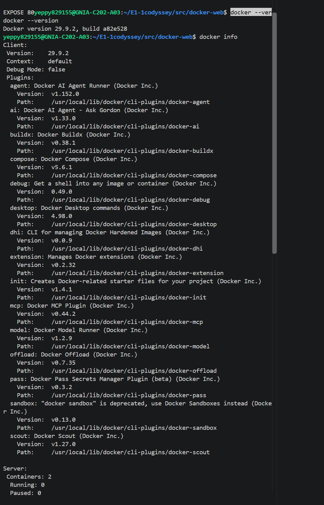

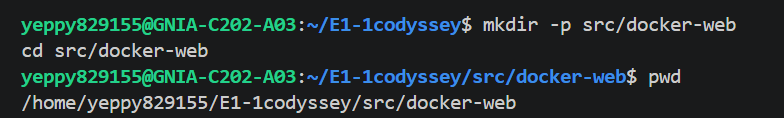

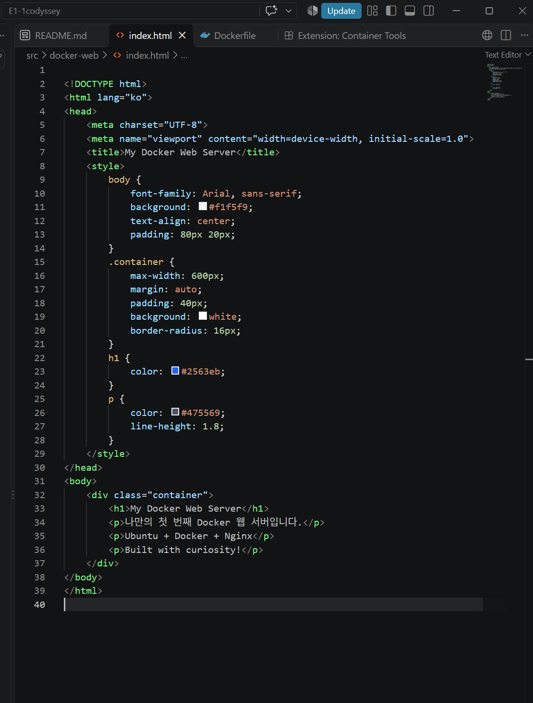

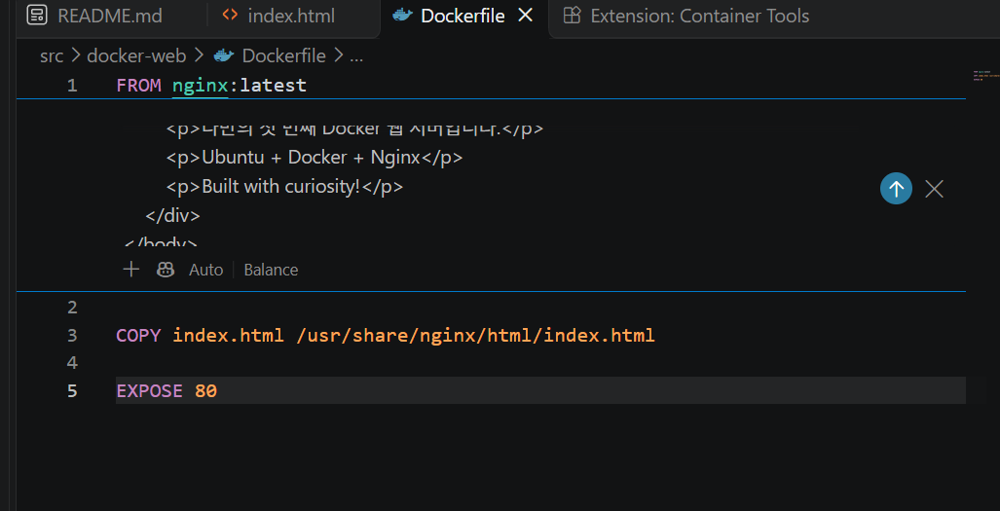

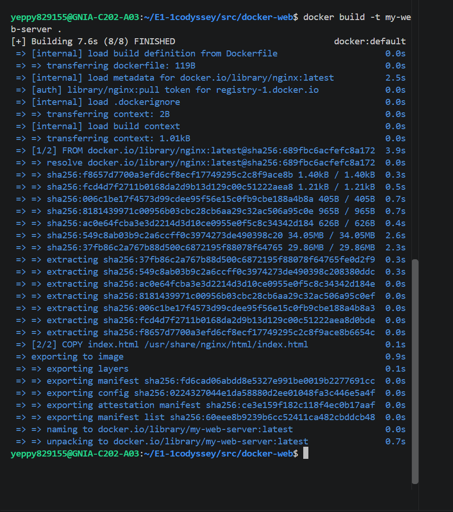

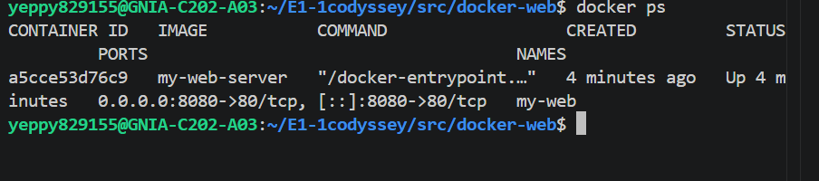

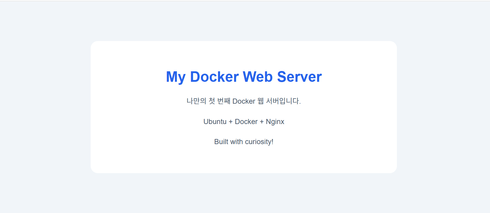

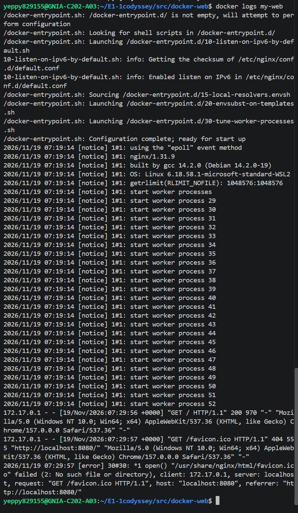

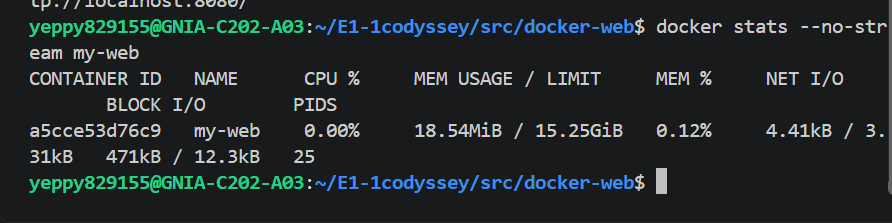

## 12. Bind Mount 실습
### 절대경로와 상대경로의 차이 및 사용 기준

Linux에서 파일이나 디렉터리의 위치를 지정하는 방법에는 절대경로와 상대경로가 있다.

**1) 절대경로(Absolute Path)**

루트 디렉터리(`/`)부터 시작하여 파일이나 디렉터리의 전체 위치를 표시하는 방식이다.

예시:

```bash
/home/yeppy829155/E1-1codyssey/src/docker-web/index.html
```

현재 작업 디렉터리가 어디인지와 관계없이 동일한 파일을 지정할 수 있다.

**2) 상대경로(Relative Path)**

현재 작업 중인 디렉터리를 기준으로 파일이나 디렉터리의 위치를 표시하는 방식이다.

프로젝트 루트 디렉터리(`/home/yeppy829155/E1-1codyssey`)에서 실행하는 경우:

```bash
src/docker-web/index.html
```

현재 위치를 기준으로 경로가 결정되므로 프로젝트 내부에서 파일을 관리할 때 편리하다.

**3) 경로 선택 기준**

| 구분 | 절대경로 | 상대경로 |
|---|---|---|
| 기준 | 루트 디렉터리(`/`) | 현재 작업 디렉터리 |
| 특징 | 위치가 명확함 | 경로가 짧고 간결함 |
| 장점 | 실행 위치가 달라도 동일한 경로 사용 | 프로젝트 구조를 유지하며 작업하기 편리함 |
| 주의점 | 사용자 계정이나 설치 위치가 달라지면 경로 수정 필요 | 현재 작업 위치에 따라 경로가 달라짐 |

**4) Docker Bind Mount 실습에서의 활용**

이번 프로젝트에서는 호스트의 `index.html` 파일을 Docker 컨테이너 내부의 Nginx 웹 서버 경로에 연결하였다.

```bash
cd ~/E1-1codyssey/src/docker-web

docker run -d -p 8080:80 --name my-web \
  -v "$(pwd)/index.html:/usr/share/nginx/html/index.html" \
  nginx:latest
```

여기서 `$(pwd)`는 현재 작업 디렉터리의 절대경로를 반환하는 명령이다.

따라서 `$(pwd)/index.html`은 호스트에 있는 파일의 절대경로가 되며, 콜론(`:`) 뒤의 `/usr/share/nginx/html/index.html`은 컨테이너 내부의 파일 경로이다.

이처럼 상대경로를 이용해 프로젝트 디렉터리로 이동한 뒤 `$(pwd)`로 호스트의 절대경로를 생성하면, 경로를 직접 입력하는 번거로움을 줄이면서 Bind Mount를 설정할 수 있다.

### 12-1. 실습 목적

호스트 컴퓨터의 파일과 컨테이너 내부 파일을 연결하여 호스트에서 수정한 내용이 컨테이너에 반영되는 것을 확인하였다.

### 12-2. Bind Mount 실행

아래 명령어는 프로젝트의 `src/docker-web` 디렉터리에서 실행한다.

```bash
cd ~/E1-1codyssey/src/docker-web

docker run -d -p 8080:80 --name my-web \
  -v "$(pwd)/index.html:/usr/share/nginx/html/index.html" \
  nginx:latest
```

### 12-3. 파일 변경 테스트

호스트 컴퓨터의 `index.html` 파일 내용을 다음과 같이 변경하였다.

```html

<p>Bind Mount 연결 테스트 성공!</p>

```

파일 저장 후 브라우저에서 변경된 문구가 표시되는 것을 확인하였다.

실행 결과:

- 호스트 파일과 컨테이너 파일 연결 성공

- Docker 이미지 재빌드 없이 변경 사항 반영

- 브라우저에서 수정 결과 확인

### 12-4. 실습 증거 자료

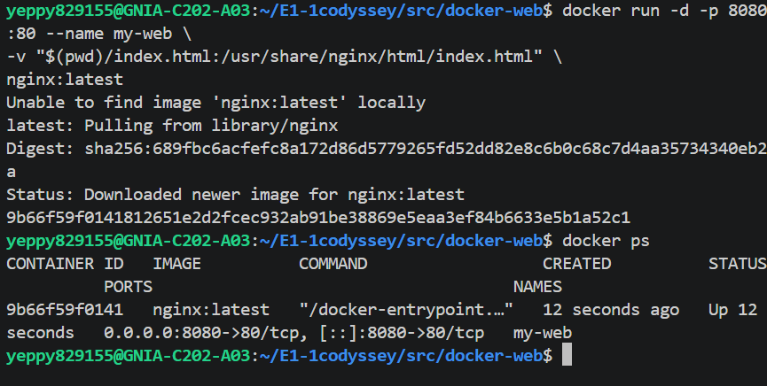

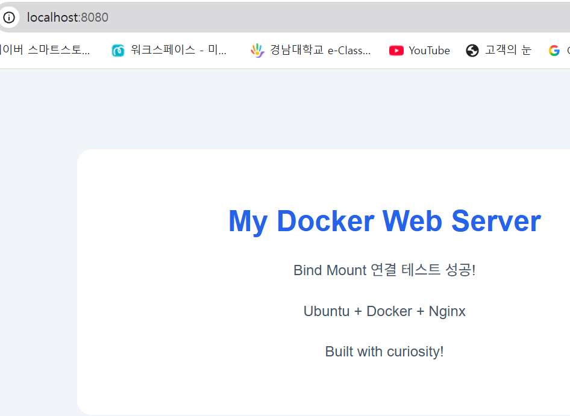

## 13. Docker Volume 데이터 영속성 실습

### 13-1. 실습 목적

Docker Volume을 생성하고 데이터를 저장한 후 컨테이너를 삭제하더라도 데이터가 유지되는지 확인하였다.

### 13-2. Volume 생성

```bash

docker volume create my-data

docker volume ls

```

실행 결과:

- Volume 이름: my-data

- Driver: local

- Volume 생성 및 목록 확인 성공

### 13-3. Volume에 데이터 저장

```bash

docker run -it --name volume-test -v my-data:/data ubuntu bash

```

컨테이너 내부에서 다음 명령어를 실행하였다.

```bash

echo "Docker Volume persistence test" > /data/test.txt

cat /data/test.txt

```

실행 결과:

- `/data/test.txt` 파일 생성

- 테스트 문구 저장 및 출력 확인

### 13-4. 컨테이너 삭제 후 데이터 유지 확인

기존 컨테이너 종료 및 삭제:

```bash

exit

docker rm volume-test

```

새 컨테이너에서 기존 Volume 연결:

```bash

docker run --rm -it -v my-data:/data ubuntu bash

```

데이터 확인:

```bash

cat /data/test.txt

```

실행 결과:

```text

Docker Volume persistence test

```

기존 컨테이너를 삭제한 후에도 Volume에 저장된 데이터가 유지되는 것을 확인하였다.

### 13-5. 실습 증거 자료

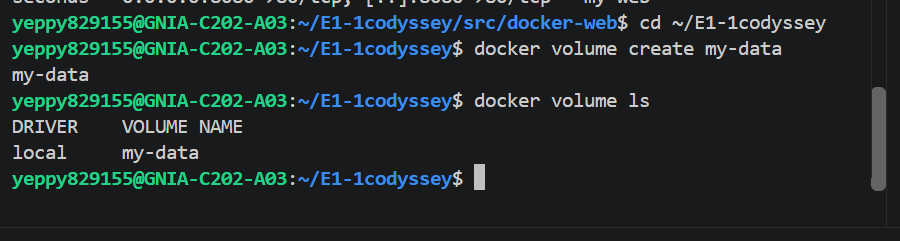

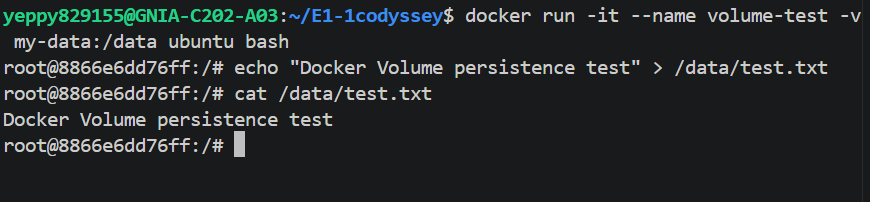

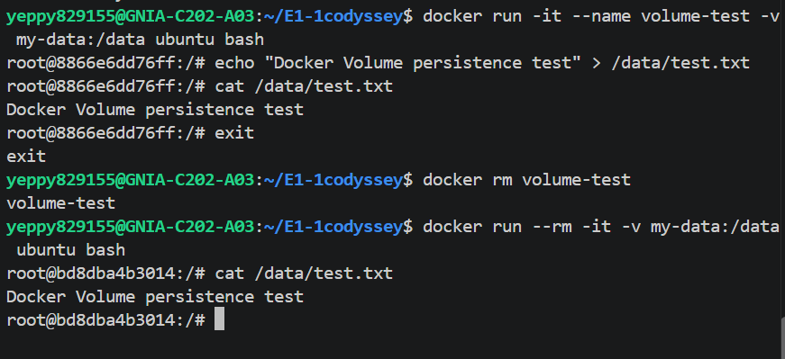

## 14. Docker 실습 결과 및 학습 내용

| 구분            | 학습 내용                  |

| :------------ | :--------------------- |

| Dockerfile    | 사용자 정의 이미지 구성 방법       |

| Docker Build  | Dockerfile을 이용한 이미지 생성 |

| Docker Run    | 컨테이너 생성 및 실행           |

| Port Mapping  | 호스트와 컨테이너의 포트 연결       |

| Docker Logs   | 컨테이너 실행 로그 확인          |

| Docker Stats  | CPU 및 메모리 사용량 확인       |

| Bind Mount    | 호스트 파일과 컨테이너 파일 연결     |

| Docker Volume | 컨테이너와 독립적인 데이터 저장      |

### 학습 결과

Dockerfile을 직접 작성하여 사용자 정의 웹 서버 이미지를 생성하고 컨테이너를 실행하였다. 포트 매핑을 통해 브라우저에서 웹페이지 접속을 확인하였으며, Docker 로그와 자원 사용량을 확인하는 방법을 익혔다.

또한 Bind Mount를 이용하여 호스트 파일의 변경 사항이 컨테이너에 반영되는 과정을 확인하였다.

Docker Volume 실습에서는 컨테이너를 삭제한 후에도 저장된 데이터가 유지되는 것을 검증하였다.

이를 통해 Docker 이미지, 컨테이너, 포트 매핑, Bind Mount, Volume의 기본 개념과 활용 방법을 학습하였다.
### Docker 포트 충돌 진단 및 해결 방법

Docker 컨테이너 실행 시 호스트에서 사용하려는 포트가 다른 프로그램이나 컨테이너에 의해 이미 사용 중이면 포트 바인딩 오류가 발생할 수 있다.

예를 들어 호스트의 8080번 포트를 컨테이너의 80번 포트에 연결하려 할 때, 8080번 포트가 이미 사용 중이면 컨테이너가 정상적으로 실행되지 않을 수 있다.

**1) 포트 사용 여부 확인**

```bash
sudo ss -ltnp | grep ':8080'
```

- `ss`: 네트워크 소켓 상태 확인
- `-l`: 대기 중인 소켓 확인
- `-t`: TCP 연결만 확인
- `-n`: 포트 번호를 숫자로 표시
- `-p`: 포트를 사용하는 프로세스 정보 표시

출력 결과가 있다면 해당 포트를 사용 중인 프로세스가 있다는 의미이다. 결과가 없다면 해당 조건에 맞는 TCP 대기 포트가 확인되지 않은 것이다.

**2) 포트를 사용하는 프로세스 확인**

```bash
sudo lsof -i :8080
```

프로세스 이름과 PID(Process ID)를 확인하여 어떤 프로그램이 포트를 사용하고 있는지 파악한다.

`lsof` 명령어가 설치되어 있지 않다면 다음 명령어로 설치할 수 있다.

```bash
sudo apt update
sudo apt install lsof
```

**3) Docker 컨테이너가 포트를 사용하는지 확인**

```bash
docker ps
```

실행 중인 컨테이너의 PORTS 항목에서 `0.0.0.0:8080->80/tcp`와 같은 포트 연결 정보를 확인한다.

**4) Docker 컨테이너가 포트를 사용 중인 경우**

해당 컨테이너를 확인한 후 정상적으로 중지한다.

```bash
docker stop 컨테이너이름
```

**5) 일반 프로세스가 포트를 사용하는 경우**

프로세스 이름과 PID를 확인한 뒤 해당 프로그램을 정상 종료한다.

```bash
kill PID번호
```

정상 종료되지 않을 경우에만 프로세스의 용도와 안전성을 확인한 뒤 강제 종료를 검토한다.

```bash
kill -9 PID번호
```

**6) 다른 포트 번호 사용**

기존 포트를 해제하기 어려운 경우 호스트 포트를 변경하여 실행할 수 있다.

```bash
docker run -d -p 8081:80 --name my-web my-web-server
```

이 경우 브라우저에서 다음 주소로 접속한다.

```text
http://localhost:8081
```

**진단 및 해결 순서**

포트 사용 여부 확인 → 사용 프로세스 확인 → Docker 컨테이너 여부 확인 → 원인에 맞게 종료 또는 포트 변경 → 컨테이너 재실행

**주의사항:** 포트를 사용하는 프로세스를 확인하지 않고 무조건 종료하면 다른 프로그램의 정상 작동에 문제가 생길 수 있으므로, 반드시 사용 주체를 먼저 확인한다.