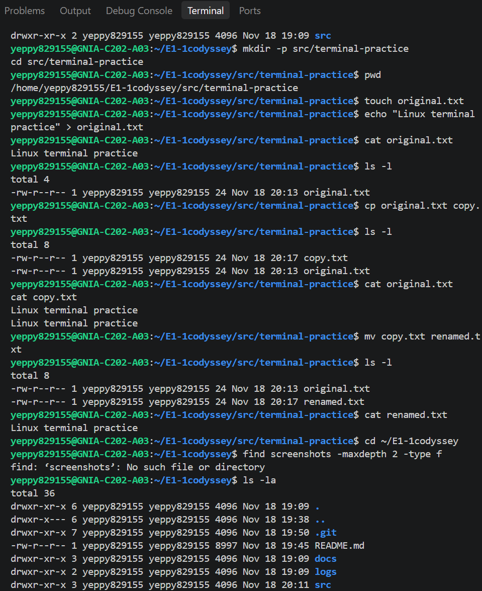
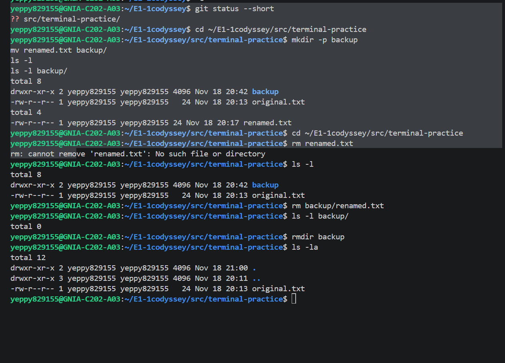
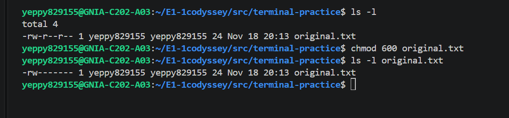
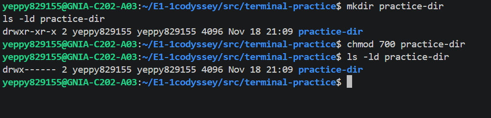

# E1-1codyssey

## 📌 프로젝트 소개
codyssey1-1 과제를 위한 웹 서버 프로젝트입니다.
## 💻 실행 환경
- OS: Windows 11
- Shell: PowerShell / WSL(Ubuntu)
- Python: 3.14
- **Git (Windows)**: 2.55.0.windows.3
- **Git (Ubuntu/WSL)**: 2.53.0

## ⚙️ 환경 설치
1. Git 설치
   - https://git-scm.com 에서 다운로드 후 설치

2. Python 설치
   - https://python.org 에서 다운로드 후 설치

3. 저장소 클론
4. Git 사용자 정보 설정
## 📁 폴더 구조
E1-1codyssey/
├── src/          # 소스 코드
├── logs/         # 로그 파일
├── screenshots/  # 스크린샷
└── README.md     # 프로젝트 설명

## ✅ 진행 현황
-  GitHub 저장소 생성
-  폴더 구조 생성 (src, logs, screenshots)
-  README.md 작성
-  학교/집 컴퓨터 Git 환경 설정
-  GitHub 연동 완료
-  웹 서버 구현 (예정)
  ## 터미널 조작 실습
1. 환경 확인 단계 진

- [x]Windows에서 WSL2 Ubuntu가 실행되는지 확인한다.
- [X] 현재 사용 중인 리눅스 배포판이 Ubuntu인지 확인한다.
- [X] Shell 종류를 확인한다.
- [X] 터미널 프로그램을 확인한다. 예: Windows Terminal, VSCode Terminal.
- [X] Git이 설치되어 있는지 확인한다.
- [X] Docker가 WSL2에서 동작하는지 확인한다.
- [x] Docker 데몬이 정상 실행 중인지 확인한다.
- [x] 확인 결과를 README의 “실행 환경” 섹션에 기록한다.
  ## 실행 환경

### 시스템 정보
- **OS**: Windows 11 (WSL2)
- **Linux 배포판**: Ubuntu 26.04.1 LTS
- **Shell**: Bash (/bin/bash)
- **Terminal**: VS Code 통합 터미널 / Windows PowerShell
- **IDE**: Visual Studio Code

### 개발 도구

- **Python**: 3.14.4
- **Git (Ubuntu)**: 2.53.0
- **Docker**: 29.9.2 (build a82e528)
- **Docker Desktop**: 실행 중
- **Docker Engine**: 정상 연결 확인

### 확인 명령어

실행 환경 확인을 위해 다음 명령어를 사용하였다.

**1. Ubuntu 버전 확인**

```bash
lsb_release -a
```

확인 결과: Ubuntu 26.04.1 LTS

**2. Shell 확인**

```bash
echo $SHELL
```

확인 결과: /bin/bash

**3. Python 버전 확인**

```bash
python3 --version
```

확인 결과: Python 3.14.4

**4. Git 버전 확인**

```bash
git --version
```

확인 결과: git version 2.53.0

**5. Docker 버전 확인**

```bash
docker --version
```

확인 결과: Docker version 29.9.2, build a82e528

**6. Docker Engine 연결 확인**

```bash
docker info
```

확인 결과:
- Docker Client 정상 확인
- Docker Server 정보 출력 확인
- Docker Engine 연결 확인

####  Git 병합 충돌 해결
- **상황**: 로컬과 GitHub에서 동시에 README.md 수정
- **원인**: 협업 환경에서 같은 파일을 두 곳에서 수정
- **해결 방법**:
  1. VS Code에서 충돌 부분 확인
  2. 중복 내용 정리 및 수동 병합
  3. `git add README.md` 실행
  4. `git commit -m "fix: README.md 병합 충돌 해결"` 커밋
  5. `git push origin main` 푸시
- **결과**: ✅ 로컬-GitHub 동기화 완료

####  학습 내용
-Git 충돌은 협업 과정에서 발생할 수 있다.
-충돌 해결은 로컬에서 수정한 후 커밋 및 푸시하는 순서로 진행한다.
-향후 예방을 위해 수정 전 원격 저장소와 동기화한다.
---

### ✅ 환경 설정 체크리스트
- [x] Windows에서 WSL2 Ubuntu 설정 확인
- [x] 현재 사용 중인 리눅스 배포판이 Ubuntu 확인
- [x] Git 설치 및 버전 확인
- [x] Python 설치 및 버전 확인
- [x] Docker 설치 및 실행 확인
- [x] GitHub 저장소 생성 및 연동
- [x] README.md 작성
- [x] Git 병합 충돌 해결

####터미널 기본 조작 실습
본 실습은 Windows PowerShell을 사용하여 프로젝트 디렉토리 확인, 파일 목록 조회, 디렉토리 이동, 파일 생성 및 파일 내용 확인을 진행하였다.

 1️⃣ 현재 위치 확인 (pwd)
pwd
실행결과
C:\Users\yeppy829155\Desktop\E1-1codyssey

 2️⃣ 일반 파일 목록 확인 (ls)
 ls
 실행결과
디렉터리: C:\Users\yeppy829155\Desktop\E1-1codyssey
docs
logs
src
README.md

 3️⃣ 숨김 파일 포함 목록 확인 (ls -Hidden)
 ls -Hidden

디렉터리: C:\Users\yeppy829155\Desktop\E1-1codyssey

Mode                LastWriteTime         Length Name
----                -------------         ------ ----
d--h--  2026-11-16  오후 8:24                   .git

 4️⃣ src 폴더로 이동 (cd src)
cd src
pwd
실행결과
C:\Users\yeppy829155\Desktop\E1-1codyssey\src

 5️⃣ 파일 생성 (New-Item hello.txt -ItemType File)
New-Item hello.txt -ItemType File

디렉터리: C:\Users\yeppy829155\Desktop\E1-1codyssey\src

Mode                LastWriteTime         Length Name
----                -------------         ------ ----
-a----  2026-11-16  오후 8:46                0 hello.txt


  6️⃣ 파일에 내용 작성 (echo & 리다이렉션)

**파일에 텍스트 작성:**
 echo "Hello, WSL2!" > hello.txt

 7️⃣ 파일 내용 확인 (cat)

**파일 내용 출력:**
cat hello.txt
Hello, WSL2!


  8. 실습 결과 및 학습 내용

| 명령어 | 기능 |
|---|---|
| pwd | 현재 작업 위치 확인 |
| ls | 파일 및 디렉토리 목록 확인 |
| ls -Hidden | 숨김 파일 확인 |
| cd | 디렉토리 이동 |
| New-Item | 새 파일 생성 |
| echo | 문자열 출력 및 파일 기록 |
| > | 출력 결과를 파일에 저장 |
| cat | 파일 내용 확인 |

실습을 통해 PowerShell의 기본 파일 및 디렉토리 관리 명령어를 익혔다.


---

## 🐳 Docker 컨테이너 실습

### 1. Hello World 컨테이너 실행

```bash
docker run hello-world
```

실행 결과:
- Docker Hub에서 hello-world 이미지 다운로드
- Hello from Docker! 메시지 출력
- Docker 컨테이너 정상 실행 확인

### 2. 이미지 및 컨테이너 확인

```bash
docker images
docker ps -a
```

실행 결과:
- 다운로드된 Docker 이미지 확인
- 컨테이너 실행 및 종료 상태 확인

### 3. Ubuntu 컨테이너 실행

```bash
docker run -it ubuntu bash
```

컨테이너 내부에서 다음 명령어 실행:

```bash
whoami
pwd
cat /etc/os-release
ls -la
```

실행 결과:
- 사용자: root
- 작업 위치: /
- Ubuntu 26.04.1 LTS 확인
- 컨테이너 내부 파일 및 디렉터리 확인

### 4. 컨테이너 재실행

```bash
docker start -ai bffe3c5c99e0
```

기존 Ubuntu 컨테이너를 다시 실행하고 내부 셸에 접속하였다.

### 5. 컨테이너 내부 파일 생성 및 데이터 유지 확인

파일 생성:

```bash
echo "Docker data persistence test" > test.txt
```

파일 내용 확인:

```bash
cat test.txt
```

컨테이너 종료 후 다시 실행하여 파일 내용을 확인하였다.

실행 결과:
- 컨테이너 종료 후에도 test.txt 유지 확인
- 동일 컨테이너 재실행 후 파일 내용 정상 출력

### 6. Nginx 웹 서버 실행

```bash
docker run -d -p 8080:80 --name my-web nginx
```

실행 결과:
- Nginx 이미지 다운로드
- my-web 컨테이너 생성 및 실행
- 호스트 8080 포트와 컨테이너 80 포트 연결

### 7. 웹 서버 접속 확인

```bash
docker ps
```

웹 브라우저 접속 주소:

http://localhost:8080

실행 결과:
- 컨테이너 실행 상태 Up 확인
- 브라우저에서 Welcome to nginx! 화면 출력 확인

### 8. 웹 서버 종료

```bash
docker stop my-web
```

실행 결과:
- my-web 컨테이너 정상 종료
- 컨테이너 삭제 없이 중지 상태 확인

### 9. 실습 결과 및 학습 내용

| 명령어 | 기능 |
|---|---|
| docker run | 새 컨테이너 생성 및 실행 |
| docker images | 이미지 목록 확인 |
| docker ps | 실행 중인 컨테이너 확인 |
| docker ps -a | 전체 컨테이너 확인 |
| docker start | 기존 컨테이너 재실행 |
| docker stop | 컨테이너 중지 |
| docker rm | 컨테이너 삭제 |
| docker run -it | 대화형 터미널 실행 |
| docker run -d | 백그라운드 실행 |
| -p | 호스트와 컨테이너 포트 연결 |
| exit | 컨테이너 내부 셸 종료 |

**학습 내용**

Docker 이미지를 이용하여 Ubuntu 컨테이너를 생성하고 내부 환경을 확인하였다. 컨테이너 내부에 파일을 생성한 후 종료 및 재실행을 통해 데이터 유지 여부를 확인하였다.

또한 Nginx 웹 서버를 Docker 컨테이너로 실행하고 포트 연결을 설정하여 웹 브라우저에서 정상적으로 접속되는 것을 확인하였다.

이번 실습을 통해 Docker 이미지와 컨테이너의 차이, 컨테이너의 생성 및 실행, 종료, 재실행 과정과 기본적인 웹 서버 실행 방법을 익혔다.
## 10. Linux 터미널 기본 조작 실습

### 10-1. 실습 목적

Linux 터미널을 이용하여 디렉토리 및 파일의 생성, 복사, 이동, 이름 변경, 삭제와 파일 내용 확인 등의 기본 명령어를 학습하였다.

### 10-2. 수행 명령어

| 명령어 | 기능 |
|---|---|
| `pwd` | 현재 작업 위치 확인 |
| `ls -la` | 숨김 파일을 포함한 목록 확인 |
| `mkdir` | 디렉토리 생성 |
| `touch` | 빈 파일 생성 |
| `echo` | 텍스트 입력 및 파일 저장 |
| `cat` | 파일 내용 확인 |
| `cp` | 파일 복사 |
| `mv` | 파일 이동 및 이름 변경 |
| `rm` | 파일 삭제 |
| `rmdir` | 빈 디렉토리 삭제 |

### 10-3. 실습 결과

- `original.txt` 파일 생성 및 내용 작성
- `copy.txt` 파일 복사 후 `renamed.txt`로 이름 변경
- `backup` 디렉토리 생성 및 파일 이동
- 파일 삭제 및 빈 디렉토리 삭제
- `ls -la`를 이용한 최종 디렉토리 상태 확인

### 10-4. Linux 파일 및 디렉토리 권한 실습

Linux의 권한은 읽기(r), 쓰기(w), 실행(x)으로 구성되며 숫자로 표현할 수 있다.

| 권한 | 의미 | 숫자 |
|---|---|---|
| r | 읽기 | 4 |
| w | 쓰기 | 2 |
| x | 실행 | 1 |

**파일 권한 변경**

```bash
ls -l original.txt
chmod 600 original.txt
ls -l original.txt
```

변경 전: `644` (`-rw-r--r--`)

변경 후: `600` (`-rw-------`)

**디렉토리 권한 변경**

```bash
mkdir practice-dir
ls -ld practice-dir
chmod 700 practice-dir
ls -ld practice-dir
```

변경 전: `755` (`drwxr-xr-x`)

변경 후: `700` (`drwx------`)

### 10-5. 트러블슈팅

**문제 1. 파일 삭제 시 No such file or directory 오류**

- 원인: 삭제하려는 파일이 현재 디렉토리가 아닌 backup 디렉토리에 위치함
- 확인: `ls -l`, `ls -l backup/`
- 해결: `rm backup/renamed.txt` 명령으로 정확한 경로 지정

**문제 2. Git diff --check에서 줄바꿈 관련 공백 오류 발생**

- 원인: Windows 환경에서 작성한 README 파일의 CRLF 줄바꿈 형식
- 해결: `git config core.whitespace cr-at-eol` 설정 후 재검사

### 10-6. 학습 내용

Linux 터미널을 활용하여 파일과 디렉토리를 직접 관리하는 방법을 익혔다. 또한 파일과 디렉토리의 권한 구조를 이해하고 `chmod` 명령어를 통해 접근 권한을 변경하는 방법을 학습하였다.## 📸 터미널 및 파일 권한 실습 증거

### 1. 터미널 기본 명령어 실습

프로젝트 내부에 실습 디렉터리를 생성하고 파일 생성, 내용 확인, 복사, 이름 변경, 이동 및 삭제 작업을 수행하였다.

사용 명령어:
```bash
pwd
ls -la
mkdir
touch
echo
cat
cp
mv
rm
rmdir
```

**실습 결과**



*그림 1. 디렉터리 및 파일 생성, 복사, 이름 변경과 내용 확인*



*그림 2. 파일 이동, 삭제 및 디렉터리 정리 결과*

### 2. 파일 권한 변경 실습

`ls -l` 명령으로 파일의 기존 권한을 확인한 후 `chmod 600` 명령으로 권한을 변경하였다.

```bash
ls -l original.txt
chmod 600 original.txt
ls -l original.txt
```

변경 결과:
- 변경 전: `-rw-r--r--` (644)
- 변경 후: `-rw-------` (600)



*그림 3. 파일 권한 변경 전후 비교*

### 3. 디렉터리 권한 변경 실습

디렉터리를 생성하고 `chmod 700` 명령으로 소유자에게만 읽기, 쓰기, 실행 권한을 부여하였다.

```bash
mkdir practice-dir
ls -ld practice-dir
chmod 700 practice-dir
ls -ld practice-dir
```

변경 결과:
- 변경 전: `drwxr-xr-x` (755)
- 변경 후: `drwx------` (700)



*그림 4. 디렉터리 권한 변경 전후 비교*
